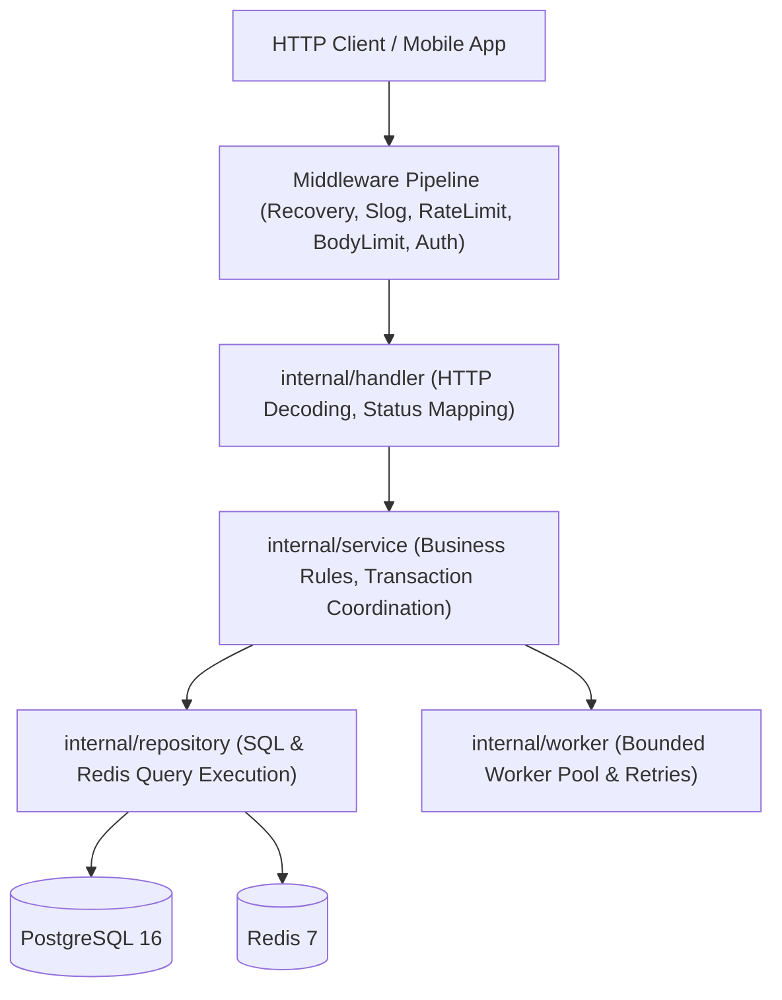

# GopherMart — Software Architecture & Design

## 1. Architectural Style: Modular Monolith
GopherMart follows the principles of Clean/Hexagonal Architecture within a modular monolith. It deliberately avoids distributed microservice overhead while strictly isolating delivery mechanisms, business policies, and persistence adapters.



## 2. Directory Layout & Layer Boundaries
```text
cmd/server/         # Entry point, dependency wiring, signal handling, graceful shutdown
internal/
  config/           # Type-safe environment variable parsing & defaults
  handler/          # HTTP controllers (Auth, Products, Cart, Orders, Health)
  middleware/       # Global & route-specific HTTP filters
  model/            # Pure domain entities, request/response DTOs
  repository/       # PostgreSQL (pgxpool) & Redis storage implementations
  service/          # Business logic, idempotency checks, transaction boundaries
  worker/           # Bounded goroutine worker pool with exponential backoff
pkg/
  database/         # Connection pool initializers for Postgres & Redis
  logger/           # Structured JSON logging (log/slog)
  response/         # Uniform API envelope helpers
  validator/        # Request payload sanitization and constraint validation
migrations/         # Reversible SQL migrations and seed data
tests/              # Concurrency, table-driven, and race detector test suites
```

## 3. Dependency Inversion & Testability
- Handlers depend on Service interfaces (`AuthService`, `ProductService`, `CartService`, `OrderService`).
- Services depend on Repository interfaces (`UserRepository`, `ProductRepository`, `InventoryRepository`, `OrderRepository`, `IdempotencyRepository`, `CartRepository`).
- Structs accept dependencies via explicit constructors (`NewOrderService(...)`), eliminating global shared state and enabling fast in-memory mocking for tests.
