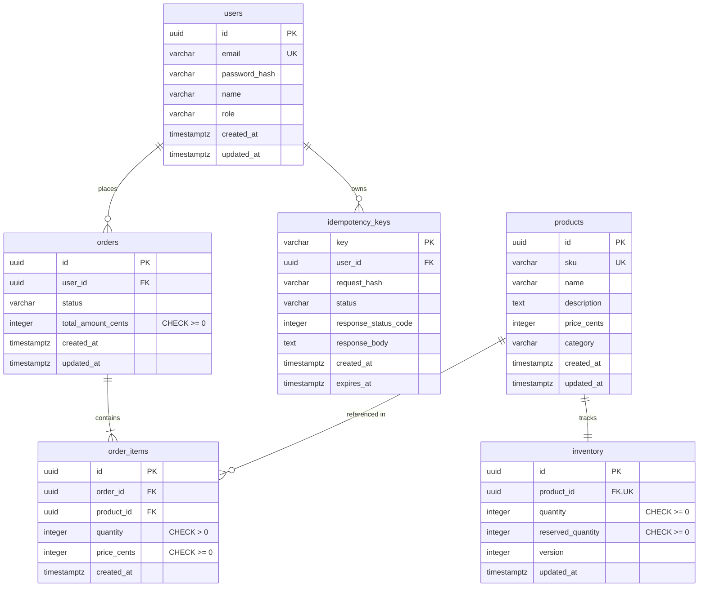

# GopherMart — Database Schema Documentation

## 1. Schema Diagram & Relationships

## 2. Integrity & Invariant Guarantees
- **Non-Negative Stock**: `inventory.quantity` is guarded by an explicit SQL constraint `CHECK (quantity >= 0)`. Any attempt to decrement past zero will immediately trigger a database constraint violation.
- **Price Representation**: Money is strictly stored as integer minor units (`price_cents`, `total_amount_cents`) to completely eliminate IEEE 754 floating-point rounding errors.
- **Cascade Rules**: Deleting a product automatically cascades to its inventory row; deleting an order cascades to its items.

## 3. Indexing Strategy
- `idx_products_category`: B-Tree index for catalog category filtering.
- `idx_inventory_product_id`: Fast lookup for stock availability checks.
- `idx_orders_user_id`: Efficient pagination of historical user orders.
- `idx_orders_status`: Fast state query filtering for fulfillment dispatch.
- `idx_order_items_order_id`: Fast join retrieval for invoice line items.
- `idx_idempotency_expires`: Enables periodic background cleanup of expired idempotency keys.

