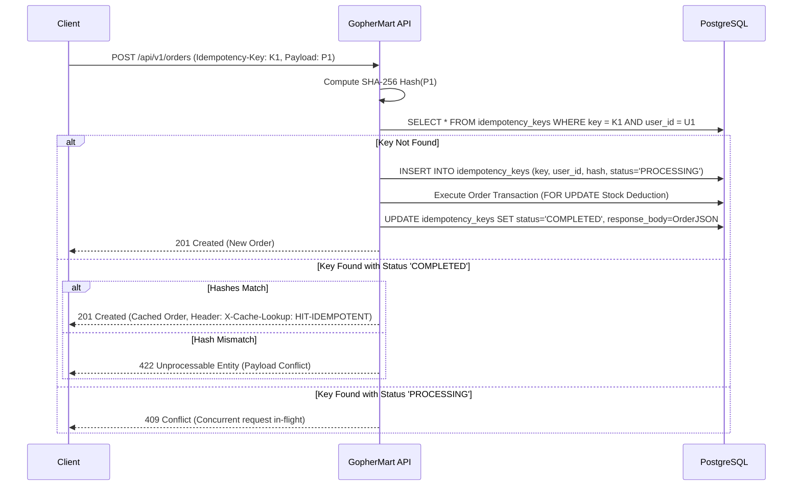

# GopherMart — Ordering & Idempotency Design

## 1. The Need for Idempotency in Mobile Quick Commerce
Mobile clients often experience network drops immediately after submitting an order. When an HTTP connection times out or breaks, the client cannot know whether the server completed the transaction. Clients automatically retry the request. Without idempotency protection, a retry would double-charge the customer and allocate a second order.

## 2. Idempotency Header & Verification Workflow
Every `POST /api/v1/orders` request requires an `Idempotency-Key: <UUID>` HTTP header.

## 3. Failure & Crash Resilience
- If the checkout transaction fails (e.g. insufficient stock), the idempotency record is marked `FAILED` or rolled back, allowing the customer to rectify cart quantities without permanently locking the key.
- Records are stamped with a 24-hour expiration (`expires_at`), matching the lifetime of dark-store picking cycles.
