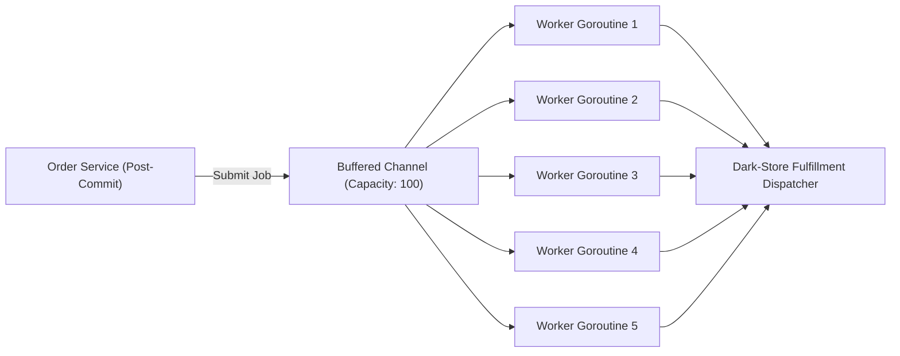

# GopherMart — Asynchronous Workers & Event Pipeline

## 1. Asynchronous Architecture
When an order transaction commits to PostgreSQL, downstream side-effects (such as notifying dark-store pickers, sending customer receipt emails, and generating delivery barcodes) must not block the HTTP checkout response.

GopherMart implements an in-process bounded worker pool utilizing native Go channels, goroutines, and standard synchronization primitives.

## 2. Queue Saturation & Memory Bounds
- Rather than spawning an unbounded number of goroutines (which risks OOM crashes under traffic spikes), the pool is bounded:
  - `WORKER_POOL_SIZE`: 5 concurrent worker goroutines.
  - `WORKER_QUEUE_SIZE`: 100 buffered job slots.
- Non-blocking submission (`select ... default`) rejects or records drops when the queue saturates, providing immediate backpressure.

## 3. Exponential Backoff & Retry Logic
Transient errors (such as network latency or downstream webhook unavailability) are retried with exponential backoff:
$$\text{delay} = 50\text{ms} \times 2^{(\text{retry} - 1)}$$
- Attempt 1: 50ms delay
- Attempt 2: 100ms delay
- Attempt 3: 200ms delay
After exceeding `WORKER_MAX_RETRIES` (3), the event is logged as permanently failed for operator alerting.

## 4. Graceful Shutdown & Drain Guarantee
During application termination (`SIGINT` or `SIGTERM`):
1. `workerPool.Stop(timeout)` closes the job queue channel, preventing new submissions.
2. Active workers continue processing their current in-flight tasks.
3. A `sync.WaitGroup` waits for all workers to return before the process exits.
4. If workers do not drain within the timeout (default 5s), the context is cancelled to ensure the process exits cleanly.
